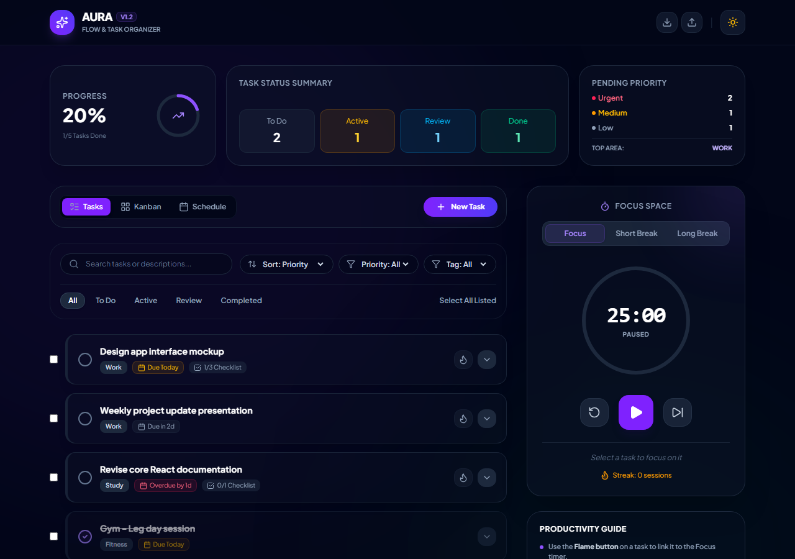

# Aura — Flow & Task Organizer

[](https://github.com/Armin0001/aura-flow/actions/workflows/ci.yml)

A feature-rich task management app built with React 19 and Tailwind CSS v4. Manage your work across a list view, Kanban board, and calendar, with a built-in Pomodoro focus timer.

**Live demo: [aura-flow-ivory.vercel.app](https://aura-flow-ivory.vercel.app)**



---

## Features

### Task Management
- **Four status stages** — To Do → In Progress → Review → Done
- **Priority levels** — High, Medium, Low with color-coded borders
- **Due dates** with overdue / due-today / upcoming badges
- **Subtasks / checklists** per task with progress tracking
- **Categories / tags** — built-in and custom
- Confetti burst when you mark a task complete 🎉

### Views
| View | Description |
|------|-------------|
| **List** | Filterable, sortable task feed with bulk selection |
| **Kanban** | Board with arrow controls to move cards between columns |
| **Calendar** | Monthly calendar with per-day task snippets |

### Focus Timer
- 25 / 5 / 15 minute Pomodoro cycles (Focus → Short Break → Long Break)
- Link any task to the active timer
- Auto-advances to the next break when a session ends
- Completing a session ticks off the task's first incomplete subtask
- Streak counter across sessions

### Productivity Dashboard
- Live completion rate ring
- Status breakdown (To Do / Active / Review / Done counts)
- Pending priority summary
- Top active category

### Other
- **Dark & light mode** toggle with no flash on load
- **Export / Import** tasks as JSON for backup or migration
- **Bulk actions** — complete or delete multiple tasks at once
- All data persisted in `localStorage` — no account needed

---

## Key decisions

- **No backend: everything lives in `localStorage`.** Tasks never leave the browser, there's no account to create and the app works offline. The tradeoff is no sync between devices, which is why Export / Import to JSON exists.
- **Task rules are plain functions, not component code.** Filtering, sorting, Kanban moves, what a finished focus session does, the dashboard numbers and due-date labels live in [`src/lib`](src/lib) as pure functions. The components call them, and the tests check them without rendering any React.
- **Due dates are local calendar days.** A due date is stored as `"YYYY-MM-DD"`. `new Date("2026-11-17")` reads that as midnight UTC, which west of UTC is the evening before, so a task due today used to show **"Overdue by 1d"** in the Americas. [`parseLocalDate`](src/lib/dates.js) reads it as local midnight instead, and day counts are rounded rather than rounded up, so 23- and 25-hour daylight-saving days don't shift a label either.
- **The edit form resets by `key`, not by an effect.** App keys the form by task id, so it mounts with that task's values. Before, a `useEffect` copied props into state, which the React Compiler lint rules flag and which left stale values behind after an edit.
- **The focus timer changes mode in one handler.** Mode, remaining time and the paused state are set together, instead of an effect reacting to the mode change one render later.

## Tests

The task rules have 32 unit tests, written with [Vitest](https://vitest.dev) in [`src/lib/*.test.js`](src/lib):

```bash
npm test
```

They cover search and filters, every sort order (undated tasks included), Kanban moves at the edges of the board, what a finished focus session does to a task, the dashboard numbers, the Pomodoro cycle, the calendar's month grid and the due-date labels.
The suite runs in the `America/New_York` timezone (set in [`vitest.config.js`](vitest.config.js)), because west of UTC is where the date bug above showed up.

CI ([`.github/workflows/ci.yml`](.github/workflows/ci.yml)) runs lint, the tests and a production build on every push and pull request.

---

## Tech Stack

| | |
|---|---|
| Framework | [React 19](https://react.dev) |
| Styling | [Tailwind CSS v4](https://tailwindcss.com) |
| Build tool | [Vite 8](https://vite.dev) |
| Icons | [Lucide React](https://lucide.dev) |
| Confetti | [canvas-confetti](https://github.com/catdad/canvas-confetti) |
| Font | [Plus Jakarta Sans](https://fonts.google.com/specimen/Plus+Jakarta+Sans) |

---

## Getting Started

**Prerequisites:** Node.js 20.19+ or 22.12+ (what Vite 8 needs)

```bash
# Clone the repo
git clone https://github.com/Armin0001/aura-flow.git
cd aura-flow

# Install dependencies
npm install

# Start the dev server
npm run dev
```

Open [http://localhost:5173](http://localhost:5173) in your browser.

### Other commands

```bash
npm run build    # Production build → dist/
npm run preview  # Preview the production build locally
npm run lint     # Run ESLint
npm test         # Run the unit tests
```

---

## Project Structure

```
src/
├── App.jsx                  # Root component — state, filtering, routing between views
├── main.jsx                 # React entry point
├── index.css                # Tailwind imports + global styles
├── lib/
│   ├── tasks.js             # Filtering, sorting, Kanban moves, focus sessions, stats
│   ├── dates.js             # Local due dates, due-date labels, month grid
│   └── focus.js             # Pomodoro modes and clock formatting
└── components/
    ├── TodoItem.jsx          # Single task card (expand, subtasks, status controls)
    ├── TodoForm.jsx          # Add / edit task form
    ├── TodoStats.jsx         # Dashboard stats row
    ├── FocusTimer.jsx        # Pomodoro timer widget
    ├── KanbanBoard.jsx       # Kanban column view
    └── CalendarView.jsx      # Monthly calendar view
```

---

## License

[MIT](LICENSE)
